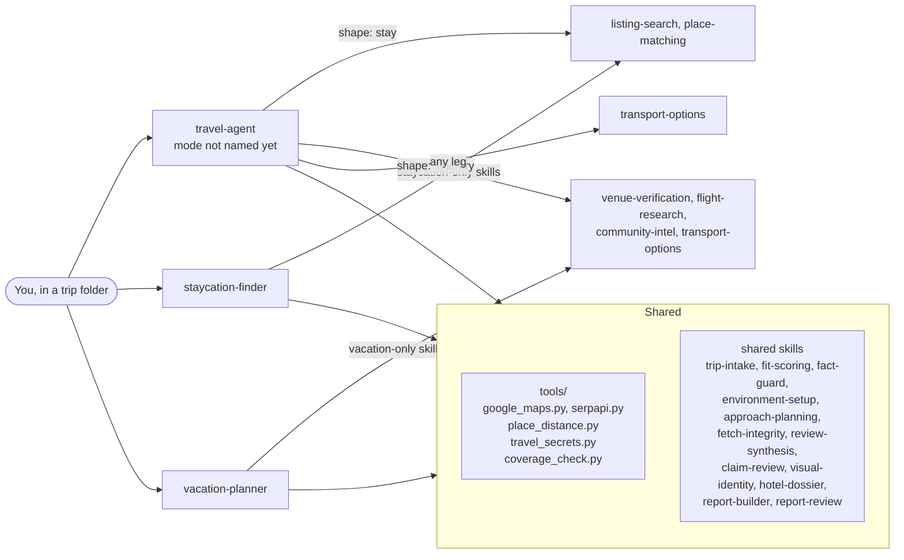

# Travel Agents

**A Claude Code plugin that plans trips the way a careful human researcher would — and proves it.** Every
figure a report shows (a price, a guest score, a drive time) traces back to a stored capture with a source and
a date; every report runs through an independent review before it's called finished. This isn't a template
that gets filled in with plausible-looking numbers — a build refuses outright when a claim has no evidence
behind it.

Three agents share one pool of skills and tools under the hood:

| Agent | What it's for |
|---|---|
| **`travel-agent`** | The front door when you haven't said whether you want a stay, an itinerary, or both. Asks, decides, then drives the same pipelines below. |
| **`staycation-finder`** | A shortlist of whole-property rentals near a home base, ranked by how well each fits this group and trip, as one designed report with an explorer table, a chart and a details panel per place, gated and reviewed. |
| **`vacation-planner`** | A multi-city itinerary kept as one spec and built into one page, which grows more complete over many sessions as research deepens and bookings land. |

Jump to: [Requirements](#requirements) · [Installation](#installation) · [Setup](#setup) · [Usage](#usage) ·
[How it works](#how-it-works) · [Known limitations](#known-limitations) · [Contributing](#contributing)

## Requirements

- **Claude Code**, with [plugin support](https://docs.claude.com/en/docs/claude-code/plugins) enabled.
- **Python 3.9 or newer**, available on your `PATH` (or a venv you point at — see [Setup](#setup)). Windows,
  macOS and Linux are all supported; every script here uses only the standard library plus two third-party
  packages (Pillow and cryptography, both installed from prebuilt wheels).
- **A Google Maps Platform API key**, with the Places API, Distance Matrix API and Geocoding API enabled.
  This is the one credential almost everything needs — place matching, drive times, landmark distances. A
  free-tier project easily covers a normal trip's usage. [Setup](#setup) covers getting one.
- Everything else is optional and the plugin tells you when you're missing it, rather than failing silently:
  a licensed review provider (Apify or SerpApi) for deeper guest-review coverage, an OpenRouteService key as
  an alternative distance provider, and the `flightclaw` MCP server for real flight-fare search. A trip that
  doesn't need one of these still works — the skill that would have used it says so and degrades gracefully.

## Installation

Replace `<your-github-username>` with whoever's repository you're installing from:

```bash
claude plugin marketplace add <your-github-username>/travel-agents
claude plugin install travel-agents@travel-agents-marketplace
```

To develop from a local clone instead of a published repo:

```bash
claude plugin marketplace add ./travel-agents
claude plugin install travel-agents@travel-agents-marketplace
```

**`<plugin root>`**, used throughout this README, means the folder this plugin is installed or cloned into —
the one that contains `skills/`, `tools/` and `requirements.txt`. Every command below that references it runs
from your **trip folder** (wherever you keep that trip's own files), not from the plugin folder itself —
scripts read and write relative to the folder you run them from.

## Setup

Three things need to exist before the first search: a Python environment with this plugin's two dependencies,
an encrypted place to keep your API key, and (only if a listing site needs it) the Playwright MCP server. The
`environment-setup` skill walks you through all three conversationally the first time an agent runs in a new
trip folder — what follows is the condensed version for reference.

### 1. Dependencies

Two non-standard-library packages: [Pillow](https://pypi.org/project/Pillow/) (image handling for reports and
palette extraction) and [cryptography](https://pypi.org/project/cryptography/) (the encrypted secrets store).
Install them into a venv **in your trip folder**, not the plugin folder — one venv per trip keeps things tidy
and means deleting a finished trip's folder cleans up its own dependencies too:

```bash
python -m venv .venv
.venv/bin/pip install -r "<plugin root>/requirements.txt"       # macOS/Linux
.venv\Scripts\pip install -r "<plugin root>\requirements.txt"    # Windows
```

### 2. Your Google Maps key, encrypted

Get a key at [console.cloud.google.com](https://console.cloud.google.com/) → APIs & Services → Credentials →
Create API key, then enable **Places API**, **Distance Matrix API** and **Geocoding API** on it (APIs &
Services → Library).

**Known limit:** this plugin calls Google's legacy endpoints (Places API (Legacy), Distance Matrix API (Legacy), Geocoding). Google moved the first two to Legacy status on 1 March 2025 and does not offer them to Cloud projects created after that (see https://developers.google.com/maps/legacy). Projects that already had them enabled keep working. If your project cannot enable them, calls fail with `REQUEST_DENIED`; use an older project, and see the migration goal to Places API (New) and the Routes API.

Keys are never stored as plaintext and never read or printed by Claude — only loaded in-memory, by name, from
an encrypted store you control:

1. Copy `skills/environment-setup/scripts/.env.template` to `secrets/.env` in your trip folder and fill in
   the keys you have.
2. Run `python "<plugin root>/skills/environment-setup/scripts/encrypt_env.py"`. It writes
   `secrets/.env.enc` + `secrets/.env.key`, verifies the round trip, then deletes the plaintext file itself.
3. Confirm everything's in place: `python "<plugin root>/skills/environment-setup/scripts/setup_check.py"`.

The encryption is not tied to you or your computer: `.env.key` sits beside `.env.enc`, and anyone holding both can decrypt them anywhere. Keep that
folder out of git (it is ignored) and out of cloud-sync folders (OneDrive, Dropbox, iCloud Drive, Google Drive). The setup step asks you where to keep it and
warns if it is in a synced folder; the recommended place is a per-user local folder (Windows `%LOCALAPPDATA%\travel-agents\secrets`, macOS
`~/Library/Application Support/travel-agents/secrets`, Linux `~/.config/travel-agents/secrets`) named by `TRAVEL_SECRETS_DIR`. In cloud sessions or CI, set the key
as an environment variable of the same name (`GOOGLE_MAPS_API_KEY`) and no file is needed.

Already have an encrypted store from another trip? Point `TRAVEL_SECRETS_DIR` at that folder instead of making
a new key every time. Need to add or change a key later? `decrypt_env.py` reverses step 2 for exactly as long
as you need to edit the file, then `encrypt_env.py` closes the window again. Full mechanics, including why
it's built this way, are in `skills/environment-setup/SKILL.md`.

### 3. Playwright MCP (only if you'll search a site with no public API)

`listing-search` needs a real browser for rental-listing sites with no API (true of Airbnb-style sites in
general). If it's not already registered in your session, add it with `claude mcp add playwright -- npx
@playwright/mcp@latest` (requires Node.js) and restart. Skip this if you're only using `vacation-planner` and
its research doesn't need a site with no public API — each agent tells you if and when it's needed.

## Usage

Open (or `cd` into) your trip folder and start Claude Code **as the agent**: `claude --agent travel-agent` (or choose it
with `/agents`). Run it as the main agent, not as a subagent: it spawns the fit scorer, the review agents and the
second-look agent, and a subagent cannot spawn subagents; each agent stops and says so if it cannot. Then describe what
you want:

> "Plan our trip to Selmere for two adults and a grandparent." *(mode not named — use `travel-agent`)*

> "Find me a ranked shortlist of private-pool rentals within 2 hours of Austin, for 4 adults and 2 children,
> under $4,000." *(a one-shot shortlist — `staycation-finder`)*

> "Help me plan a 12-day trip across Portugal and Spain for a family of four, with real restaurant and hotel
> research." *(an open-ended, evolving itinerary — `vacation-planner`)*

What happens next depends on the agent, but the shape is always the same: it asks before it assumes (group
size, dates, budget, and — for `travel-agent` — what should make a property or itinerary stand out *for this
specific group*, not a generic one), runs its research and verification pipeline, and hands you back one
finished file in your trip folder: one designed HTML page, built from a spec you can keep editing as a
`vacation-planner` trip develops (the spec, not the page, is what changes). Nothing is presented
as finished without having passed that pipeline's own review step first; if you ask for something faster, the
agent says so plainly rather than quietly skipping the check.

## How it works

`travel-agent` doesn't dispatch to the other two agents as subagents — it runs its own short intake
(`trip-intake`), decides the request's shape, and then drives the *same* underlying pipelines directly:



`staycation-finder` and `vacation-planner` stay separate agents, directly invocable on their own, rather than
being folded entirely into `travel-agent` — they're genuinely different interaction models (one gathers every
requirement up front and runs a pipeline once; the other is an open conversation across many sessions), and
collapsing all three into one description would blur the signal Claude uses to pick the right one.

<details>
<summary><strong>What the agents actually share</strong></summary>

- **`tools/`** — code used by scripts across several skills: `google_maps.py` (the one Places/Geocoding/
  Distance Matrix client, with a shared status check), `serpapi.py` (Google Flights and Maps reviews through
  SerpApi), `place_distance.py` (distances from any origins to named places), `travel_secrets.py` (the one
  credential loader — reads the encrypted store, never prints a key), `coverage_check.py` (the field-coverage
  checker behind `fetch-integrity`), `intake_checks.py` (the street-address and placeholder checks both intake validators share), plus the number and text helpers `numfmt.py`, `textnorm.py` and `jsonfile.py`, and the development tools `run_selftests.py`, `check_agents.py` and `privacy_scan.py` (see SECURITY.md).
- **`environment-setup`** — venv, secrets and Playwright setup, identical across every agent.
- **`review-synthesis`** and **`claim-review`** — the judgement and review principles every agent uses. The
  full corpus-plus-judge pipeline suits `staycation-finder`'s many-property comparisons; `venue-verification`
  states the same rules at a weight that fits a single lookup.

`requirements-intake` (the stay search's hard filters; every agent uses it when stays are searched) and `trip-constraints-intake`
(the itinerary's fixed constraints; `travel-agent` and `vacation-planner` only) both build on `trip-intake`, the first pass every agent runs:
it lists back what the user already said, then asks only the gaps, so neither re-asks what it already holds.

</details>

<details>
<summary><strong>Full skill catalogue</strong></summary>

Every skill lives in `skills/<name>/` with its own `SKILL.md`.

| Skill | Used by | Purpose |
|---|---|---|
| `trip-intake` | All | One free-form question, then multiple-choice follow-ups for the gaps, ending in a fit profile the user confirms: what makes a place rank higher or lower for this group and trip. |
| `fit-scoring` | All | A dedicated fit-scorer agent proposes contextual overlays on the guest score from the captured facts and the agreed fit profile; `apply_overlays.py` re-ranks; the judgement reviewer challenges them. |
| `transport-options` | travel-agent, vacation-planner | Compares air, road and rail for one leg and recommends one with stated reasons. |
| `approach-planning` | All | Write the research plan (sources, search variants, expected yield) before fetching; check the run against it afterwards. |
| `fact-guard` | All | The fail-closed gate and its `pipeline.py` driver (brief, spec, offline capture store, derived review, fresh second look, knowledge base, gate, build, check): every published figure captured from a source fit for its kind of claim and fresh enough; two independent sources for critical facts; the rank score recomputed; plan consistency; spot check after the review. |
| `hotel-dossier` | All | The per-place dossier contract: map listing, guest ratings per platform, reviews read, photos, with a reason for every missing section. |
| `claim-review` | All | The review panel: calibrated facts, judgement and plan reviewers plus a cold reader, each a fresh agent; the review gate computes the verdict from their ledgers. |
| `community-intel` | travel-agent, vacation-planner | Find what past visitors say (forums, Reddit, Google reviews, X) rather than the listicle consensus, and store sourced findings. |
| `environment-setup` | All | One-time setup: Python venv, encrypted secrets store, Playwright MCP server, and the first-run credential walkthrough. |
| `fetch-integrity` | All | Coverage and sanity check after every fetch of an external page or API, so silent structure drift fails loudly. |
| `flight-research` | travel-agent, vacation-planner | Real flight fares (SerpApi's Google Flights, flightclaw) and miles redemption, guarding against per-direction vs round-trip mix-ups. |
| `listing-search` | staycation-finder, travel-agent, vacation-planner (ranked stays) | Collect rental or hotel candidates (search, map-grid sweep, unfiltered sweep), parse listing pages, compute drive times, find beyond-platform leads. |
| `place-matching` | staycation-finder, travel-agent, vacation-planner (ranked stays) | Match each listing to its Google Maps place, with no manual per-listing overrides. |
| `report-builder` | All | One generic block engine for every report and itinerary: cards, an explorer table (filters, group-by, compare), a chart, day plans, transport legs, booking ledgers, cost comparisons, a decision log and research notes. `stay_spec.py` converts a stay search into a spec. |
| `report-review` | All | Review the built report by falsification: deterministic audits, claim ledger, cold reader, design sweep. |
| `requirements-intake` | staycation-finder, travel-agent, vacation-planner (ranked stays) | Gather every hard filter and constraint before any search begins. |
| `research-delegation` | travel-agent, vacation-planner | Fan wide research sweeps out to parallel subagents, then audit their output. |
| `review-synthesis` | All | Read reviews from two sources into a deduplicated corpus and produce the themes and concerns (each citing its reviews) that the guest score and the overindexing rule are built on. |
| `trip-constraints-intake` | travel-agent, vacation-planner | The itinerary's fixed constraints, asking only what `trip-intake` didn't answer. |
| `venue-verification` | travel-agent, vacation-planner | Verify one named venue or transit leg (existence, status, hours, rating, distance) before it goes into the document. |
| `visual-identity` | All | Source a licence-checked destination photo and derive a bespoke colour palette from it. |

</details>

<details>
<summary><strong>Repository layout</strong></summary>

```
travel-agents/
  .claude-plugin/        plugin.json (manifest, version), marketplace.json
  agents/                travel-agent.md, staycation-finder.md, vacation-planner.md
  skills/<name>/         SKILL.md plus that skill's own scripts/ (and template/ or templates/)
  skills/claim-review/calibration/   frozen synthetic fixtures for the review calibration
  tools/                 shared code (Maps and SerpApi clients, secrets loader, coverage and intake checks, number and text helpers) and dev tools: run_selftests.py, check_agents.py, privacy_scan.py
  requirements.txt
  LICENSE, README.md, CONTRIBUTING.md, SECURITY.md
```

Code specific to one capability lives in that skill's folder. Only cross-cutting infrastructure lives in
`tools/`. Hand judgement is part of the design, not a gap: per-property score reasons, beyond-platform leads
and day-by-day narrative are written fresh for each trip, following the pattern each skill lays out — the
search, matching, scoring, building and verification engine is what's reusable. No trip-specific data, real or
sample, ships in this repository.

</details>

<details>
<summary><strong>Tests and validation</strong></summary>

One command runs every offline check (no network, no key): each script's `selftest`, the calibration fixtures'
integrity, the agent frontmatter check and a compile of every `.py` file; it exits 1 if anything fails:

```
python "<plugin root>/tools/run_selftests.py"
```

Any script with a `selftest` subcommand is picked up automatically (`python <script> selftest`). The pieces, if you
want one alone:
- **Self-tests:** `guard.py`, `capture_store.py` and `pipeline.py` (fact-guard), `review_gate.py` (claim-review),
  `compare_modes.py` (transport-options), `trip_intake.py`, `apply_overlays.py`, `stay_spec.py`, `build_page.py` and
  the other scripts under `skills/` and `tools/`, each as `python "<plugin root>/skills/<skill>/scripts/<script>.py" selftest`.
- **Calibration fixtures:** `python "<plugin root>/skills/claim-review/scripts/calibrate.py" verify --domain stay` (and
  `--domain itinerary`) confirms the frozen fixtures are unmodified. Never edit a frozen fixture to make a reviewer pass.
- **Deterministic audits (need a built run):** `report-review/scripts/audit_consistency.py` on the stay search's rows. A
  report's figures, an itinerary's plan and its bookings are checked by fact-guard's gate.
- **Live matcher check (uses Google quota, needs a key):**
  `python "<plugin root>/skills/place-matching/scripts/live_match_check.py" [seed]`.

See [CONTRIBUTING.md](CONTRIBUTING.md) for the full pre-pull-request checklist.

</details>

## Known limitations

- **Browser search needs the Playwright MCP server.** The agents are granted it, but it must be registered with Claude
  Code (`environment-setup` walks through it); without it, a hotel search falls back to Booking.com landmark pages (indicative prices
  only) and a rental search cannot run.
- **`flight-research` uses SerpApi's Google Flights and `flightclaw`** (set up step by step by `environment-setup`) and an upstream
  library that has broken before when Google Flights changed its page. A live search result is never a
  confirmed bookable price — always verify before you book.
- **Award (miles) search** is best done with [seats.aero](https://seats.aero); this plugin doesn't query it.
- **Listing sites change without notice.** `fetch-integrity` makes a structure drift fail loudly, but the fix
  is manual.
- **Google Places returns 5 reviews per call (about 10 per place with two calls).** A guest score needs at least 20 rated
  reviews from each of two sources (or one source plus a second declared unavailable with its reason), so it needs a licensed review provider (SerpApi or Apify); without one, places have no guest score, so no fit ranking either: the report lists them in search order and says it is not ranked.
- **Airbnb's listed coordinates are deliberately jittered** (~1.2 km), so place matching uses name plus
  proximity, and a match near a boundary can occasionally be wrong.
- **Older hand-edited itinerary documents** (from before itineraries became specs) can still be read, but this plugin no
  longer edits or rebuilds them. Start a spec and carry the facts across.
- **Scores are judgement aids, not guarantees.** Pet rules, real-bed layouts and refund terms are often
  unpublished; reports say so per property rather than guessing.

## Third-party data and terms

This plugin calls third-party services and, for the handful of listing sites with no public API, fetches
public listing pages. You're responsible for complying with each service's own terms:

- **Google Maps Platform** — caching Place content beyond place IDs is restricted by its terms.
- **Airbnb, Booking.com and similar sites** — automated access may fall outside their terms of service.
- **Travel articles and forum posts** quoted in a report belong to their authors.
- **Photos** sourced via `visual-identity` (Openverse) carry individual licences — check each one before you
  publish anything that uses them.

## Contributing

See [CONTRIBUTING.md](CONTRIBUTING.md) for ground rules, layout conventions, and the pre-pull-request
checklist. Report security problems privately, per [SECURITY.md](SECURITY.md) — not as a public issue.

## License

MIT. Copyright (c) 2026 pallab-de. See [LICENSE](LICENSE).
